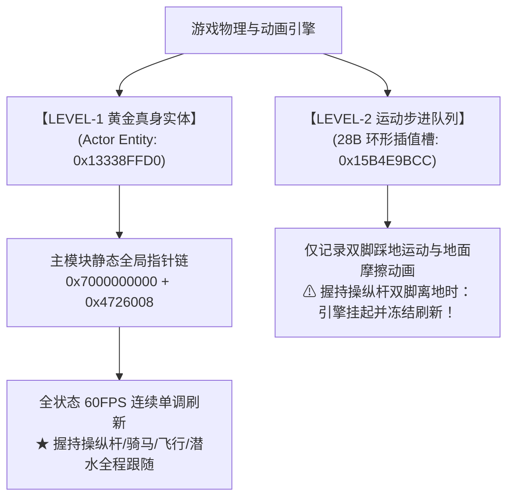
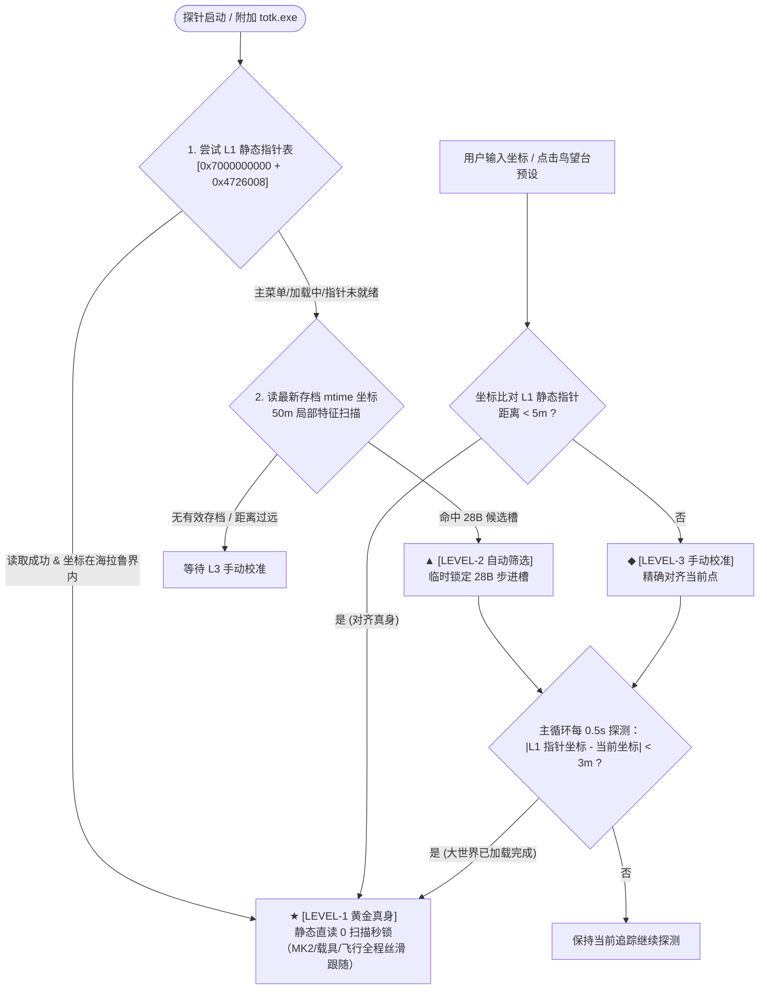

# TOTKnavi PC 重编译版定位技术与真身追踪核心手册

> **归档说明**：本文档记录 TotK-PC（TotK-Recomp）深度重编译版中，林克真实世界坐标的逆向追踪、三级锁定架构与动态升阶机制，沉淀跨版本自适应与全场景（含 MK2 操纵杆飞行）连续追踪的核心经验。
> **适用版本**：TOTKNavi v3.1.2 起生效。

---

## 一、 问题背景与关键现象复盘

在 TOTKNavi v3.1.0 ~ v3.1.1 期间，PC 重编译版用户反馈存在一个典型现象：
1. **地面正常，飞行卡死**：林克在地面跑动时定位正常刷新，但**一旦双手握住操纵杆驾驶 MK2（左纳乌风扇载具）升空飞行，地图图标立刻卡在起飞原点定格不动**；
2. **落地瞬间恢复**：当林克跳离操纵杆、双脚落回地面时，定位瞬间跳变至当前最新位置并恢复正常跟随；
3. **环境差异**：本地开发机实机测试飞行正常跟随，而测试用户机上飞行必然卡死。

---

## 二、 内存机制深潜：真身实体 vs 运动步进队列

通过对 16GB 虚拟内存全空间指针引用的逆向拓扑分析，揭示出游戏引擎在内存中对角色位置的多层维护机制：

### 1. LEVEL-1 黄金真身实体（Actor Entity，如 `0x13338FFD0`）
- **物理角色**：世界物理引擎驱动林克的唯一“母体”。结构体后方紧随 Havok 动力学参数（`Ap_Land_Obj`, `Ap_Drag_Obj` 等）。
- **生命周期与刷新**：无论林克处于何种交互状态（徒步、疾跑、攀爬、滑翔、游泳、骑马、**坐在操纵杆上开 MK2**），该坐标每帧保持 60FPS 连续递增/递减平滑刷新。
- **引用拓扑**：在 PC 重编译版的主模块内存段中，存在恒定的全局管理指针（如 `0x4726008` 等）直接持久持有该结构体基址。

### 2. LEVEL-2 运动步进队列（28B 物理环形槽，如 `0x15B4E9BCC`）
- **物理角色**：动画系统用于计算脚步落点、脚步声、地面摩擦粒子的双向 28 字节环形记录槽（12B 坐标 + 16B 四元数旋转）。
- **卡死致命根因**：林克一旦爬上操纵杆，双腿离开地面，动画系统判定**“林克当前未处于双足行走状态”，立即挂起并冻结该队列的写入**。只要林克不松开操纵杆，槽内数值恒定不变；直至落地恢复双足运动，队列才重新开始滚写。
- **诊断推论**：**用户电脑在开飞机卡死，根本原因不是操纵杆改变了坐标地址，而是探针未进入 LEVEL-1，回退到了 LEVEL-2 步进队列！**

---

## 三、 跨版本自适应适配的四大陷阱与突破

为什么用户机器未能进入 LEVEL-1 静态直读？对比两台机器的运行环境与真实日志，锁定了四个隐蔽的工程陷阱：

| 陷阱点 | 旧逻辑做法 | 破坏后果 | 突破重构方案 |
| :--- | :--- | :--- | :--- |
| **1. 字符魔数死检** | 读基址头 64 字节强制比对 `MOD0` 字符串 | 在特定显卡驱动（如 AMD RX6500 XT）、Windows 页保护或打了补丁（`fps60`, `zstd`, `mouse_direct`）的环境中，头部字符变化导致直接误杀合法基址 | **基址直接采纳**：TotK-Recomp 核心固定映射基址为 `0x7000000000`，只要内存页处于已提交且可读状态，直接确认为主模块 |
| **2. 日志正则空格** | 匹配 `loaded main at (0x[0-9a-fA-F]+)` | 官方日志以格式化输出 `loaded main     at`（5 个空格），固定 1 个空格的正则 100% 匹配失败 | **全空格容错正则**：升级为 `loaded\s+main\s+at\s+(0x[0-9a-fA-F]+)`，且提取到基址后不再卡死魔数 |
| **3. 缓存早死锁** | 初次调用探测为 0 即永久锁死 `mainChecked = true` | 探针先于游戏启动、或游戏处于启动黑屏/主菜单时，基址未命中被永久锁死为 0，进入大世界后也绝不再重试 | **动态就绪锁**：仅当 `foundBase != 0` 时才冻结缓存，未命中时保持动态重试能力 |
| **4. 缺乏动态升阶** | 开局未命中 L1 则永久停留在 L2 槽位循环读取 | 一旦开局由于时机错失静态指针，用户全程陷入 28B 队列，开飞机必卡 | **运行态动态升阶**：主循环每 0.5s（10 帧）拿当前追踪坐标去对齐 L1 静态指针，距离 $< 3$m 瞬间无感升阶 |

---

## 四、 核心架构：以“锁定 L1 真身”为终极目标的三级闭环

体系整体设计原则：**无论开局是从 L1、L2 还是 L3 进入，所有通路的唯一终极归宿都是升阶至 L1 黄金真身。**

---

## 五、 防反复横跳的“免死金牌”法则

模拟器（Ryujinx / Eden / Cemu）与 PC 版早期最常踩的坑为**“神经过敏式重扫”**：当林克进行大距离位移或进出神庙时，误判为地址失效触发全盘重扫，导致地图图标疯狂闪烁、来回横跳。

为彻底根治此问题，对 **L1 黄金真身** 确立三条绝对法则：

1. **大位移传送不解锁**：
   当检测到两帧距离 $\ge 50$m（`warpDist`），直接判定为大地图传送（Warp），平滑同步新坐标，**严禁在 L1 下触发槽位震荡重扫**；
2. **神庙与读图保持（Shrine Hold）**：
   进神庙、开大地图、暂停菜单、死亡读条期间，坐标暂时不动时保持上一帧输出，绝对不判定为掉锁；
3. **唯一的失效条件**：
   **只有游戏进程退出（PID 消失）或内存基址被彻底注销**时，探针才重置定位状态。只要游戏在跑、内存可读，**L1 一旦锁定，即终生锁定**！

---

## 六、 工程交付与文件减法规范

1. **统一核心，消除双可执行文件冗余**：
   - 彻底删除发布包中冗余的命令行副本 `totknavi-pc.exe`，统一以 `totknavi-core.exe` 作为 GUI 后台的唯一执行体；
   - 用户唯一入口仅为 `TOTKnavi.exe`；
   - 压缩包从 11.6MB 瘦身至 8.4MB（净减 3.2MB）。
2. **日志全透明化**：
   - 底层各级判定日志（`[LEVEL-1 黄金真身]` vs `[LEVEL-2 自动筛选]` vs `[LEVEL-3 手动校准]`）全部实时汇入前端 UI 日志面板；
   - 支持一键导出包含内存地址与状态跃迁记录的 `xnavi-gui-core.log` 完整诊断包。
